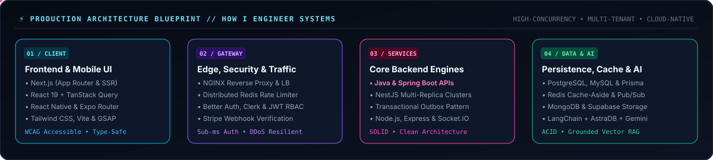

  <!-- ======================= ANIMATED TYPING HEADLINE ======================= -->
  

   

  <!-- ======================= RECRUITER QUICK-ACTION CTA BAR ======================= -->
  

    
    
    
    
    
  

  <!-- ======================= QUICK JUMP NAVIGATION ======================= -->
  

    
      <a href="#-recruiter-executive-briefing"><strong>🎯 Recruiter Briefing</strong></a> &nbsp;•&nbsp;
      <a href="#-tech-stack--engineering-arsenal"><strong>🛠️ Tech Stack (TS / Java / Spring Boot / NestJS)</strong></a> &nbsp;•&nbsp;
      <a href="#-flagship-engineering-showcase"><strong>🚀 Flagship Projects</strong></a> &nbsp;•&nbsp;
      <a href="#-complete-public-repository-index-all-31-repos"><strong>📚 All 31 Public Repos</strong></a> &nbsp;•&nbsp;
      <a href="#-github-telemetry--contribution-analytics"><strong>📊 Live Telemetry</strong></a> &nbsp;•&nbsp;
      <a href="#-lets-build-something-worth-remembering"><strong>📬 Contact</strong></a>
    
  

  

## 🎯 Recruiter Executive Briefing

  

  

## 🛠️ Tech Stack & Engineering Arsenal

  

 

  

 

| Domain | Core Technologies & Tools |
| :--- | :--- |
| **💻 Languages** |         |
| **⚙️ Backend & Enterprise** |        |
| **🎨 Frontend & Mobile** |         |
| **🗄️ Data, Caching & ORM** |        |
| **☁️ Cloud, DevOps & Infra** |         |
| **🤖 AI, Auth, Payments & QA** |         |

  

## 🚀 Flagship Engineering Showcase

> **Recruiter Note:** Below are my **10 flagship engineering projects** demonstrating distributed backend architecture, full-stack product delivery, AI RAG pipelines, and cloud deployment. For the complete list of **all 31 public repositories**, see the [Complete Public Repository Index](#-complete-public-repository-index-all-31-repos) immediately below.

<table>
  <tr>
    <td width="50%" valign="top">
      <h3>🏗️ <a href="https://github.com/kingsmark16/DocuScale">DocuScale — Multi-Tenant B2B SaaS Engine</a></h3>
      

        A high-availability, multi-tenant B2B SaaS document engine (<em>"Mini-Notion"</em>) engineered for high-concurrency workloads. Features a <strong>stateless NestJS backend cluster scaled across 3 Docker replicas</strong>, managed by an <strong>NGINX load balancer</strong> with IP rate-limiting, <strong>Better Auth</strong>, and custom <strong>Redis look-aside caching</strong> that drops RBAC authorization checks to <strong>sub-millisecond speeds</strong>.
      

      

        <code>Next.js</code> <code>NestJS (3x Replicas)</code> <code>PostgreSQL</code> <code>Prisma</code> <code>Redis</code> <code>NGINX</code> <code>Docker</code> <code>Better Auth</code>
      

      

        
        
      

    </td>
    <td width="50%" valign="top">
      <h3>🧠 <a href="https://github.com/kingsmark16/mc.ai">MC.AI — Grounded RAG Document Assistant</a></h3>
      

        Full-stack <strong>Retrieval-Augmented Generation (RAG)</strong> application that transforms uploaded <strong>PDF, DOCX, and TXT</strong> documents into vector-indexed, searchable knowledge bases and delivers context-grounded answers with zero-hallucination guardrails.
      

      

        <code>React</code> <code>TypeScript</code> <code>NestJS</code> <code>LangChain</code> <code>AstraDB Vector</code> <code>Gemini AI</code>
      

      

        
        
      

    </td>
  </tr>
  <tr>
    <td width="50%" valign="top">
      <h3>💳 <a href="https://github.com/kingsmark16/payment-integration">Stripe Payment Integration Monorepo</a></h3>
      

        Full-stack payment processing monorepo built with <strong>NestJS, React (Vite + TypeScript), and Stripe Embedded Checkout Elements</strong> (<code>ui_mode: 'elements'</code>). Implements raw-body cryptographic <strong>Stripe webhook signature verification</strong>, idempotent fulfillment, and <strong>TanStack Query v5</strong> state synchronization.
      

      

        <code>NestJS</code> <code>React</code> <code>TypeScript</code> <code>Stripe API &amp; Webhooks</code> <code>TanStack Query</code> <code>pnpm Workspaces</code>
      

      

        
        
      

    </td>
    <td width="50%" valign="top">
      <h3>💌 <a href="https://github.com/kingsmark16/Letterly">Letterly — Personalized Webpage Platform</a></h3>
      

        Full-stack monorepo platform for crafting personalized interactive webpages for celebrations, messages, and meaningful occasions, complete with custom music, workspace cards, authentication, and shareable unique links.
      

      

        <code>Next.js</code> <code>NestJS</code> <code>TypeScript</code> <code>PostgreSQL</code> <code>Prisma</code> <code>Better Auth</code> <code>Turborepo</code> <code>Docker</code>
      

      

        
        
      

    </td>
  </tr>
  <tr>
    <td width="50%" valign="top">
      <h3>⚡ <a href="https://github.com/kingsmark16/NestFlux">NestFlux — Microservice File &amp; Image Engine</a></h3>
      

        A microservice-based file ingestion and asynchronous image processing platform built in a pnpm monorepo. Features an <strong>API Gateway</strong> and a reliable <strong>Transactional Outbox Dispatcher</strong> for scheduled event-driven asset processing.
      

      

        <code>NestJS</code> <code>Microservices</code> <code>Transactional Outbox</code> <code>TypeScript</code> <code>Docker Compose</code> <code>pnpm</code>
      

      

        
        
      

    </td>
    <td width="50%" valign="top">
      <h3>📓 <a href="https://github.com/kingsmark16/Tinta">Tinta — Private Digital Diary (Mobile + API)</a></h3>
      

        Cross-platform private digital diary and mood-tracking monorepo where users write daily reflections, track emotional trends, and preserve memories. Built with an <strong>Expo Router (React Native)</strong> mobile client and a <strong>NestJS + Vitest</strong> backend.
      

      

        <code>React Native</code> <code>Expo Router</code> <code>NestJS</code> <code>TypeScript</code> <code>Prisma</code> <code>PostgreSQL</code> <code>Vitest</code>
      

      

        
        
      

    </td>
  </tr>
  <tr>
    <td width="50%" valign="top">
      <h3>🛡️ <a href="https://github.com/kingsmark16/Redis-caching-rate-limiter-with-nestjs-docker-and-nginx">Redis Caching &amp; Distributed Rate Limiter</a></h3>
      

        Production-grade <strong>NestJS CRUD Task API</strong> featuring <strong>cache-aside Redis caching</strong> (TTL + automatic invalidation), distributed rate limiting across replicas, health/readiness probes, request correlation IDs, <strong>NGINX HTTPS reverse proxy</strong>, Swagger docs, and <strong>Jest E2E tests</strong>.
      

      

        <code>NestJS</code> <code>Redis</code> <code>PostgreSQL</code> <code>Prisma</code> <code>Docker Compose</code> <code>NGINX</code> <code>Swagger</code> <code>Jest E2E</code>
      

      

        
        
      

    </td>
    <td width="50%" valign="top">
      <h3>🎓 <a href="https://github.com/kingsmark16/PARSUWise">PARSUWise — Centralized Academic LMS</a></h3>
      

        Capstone role-based <strong>Learning Management System</strong> for academic institutions supporting Administrators, Faculty, and Students with course authoring, interactive quizzes, <strong>real-time Socket.IO discussion forums</strong>, progress analytics, and <strong>verifiable digital certificates</strong>.
      

      

        <code>React 19</code> <code>Express.js</code> <code>PostgreSQL</code> <code>Prisma</code> <code>Socket.IO</code> <code>Clerk Auth</code> <code>Tailwind CSS</code>
      

      

        
        
      

    </td>
  </tr>
  <tr>
    <td width="50%" valign="top">
      <h3>📼 <a href="https://github.com/kingsmark16/CollegeRage">CollegeRage — Cloud Media Memory Vault</a></h3>
      

        Interactive 4K digital memory gallery with background audio, visitor analytics, and a secure admin dashboard backed by <strong>Dropbox cloud storage</strong>. Deployed as a multi-container <strong>Docker + NGINX</strong> application on <strong>Microsoft Azure</strong>.
      

      

        <code>TypeScript</code> <code>React</code> <code>Express.js</code> <code>PostgreSQL</code> <code>Prisma</code> <code>Docker</code> <code>NGINX</code> <code>Azure</code>
      

      

        
        
      

    </td>
    <td width="50%" valign="top">
      <h3>✨ <a href="https://github.com/kingsmark16/portfolio">Interactive Developer Portfolio (mcanghel.fun)</a></h3>
      

        Motion-rich personal portfolio website built with <strong>Next.js, TypeScript, and GSAP</strong> showcasing projects, technical toolkit, live GitHub contribution calendar integration, internship milestones, and downloadable resume.
      

      

        <code>Next.js</code> <code>TypeScript</code> <code>GSAP</code> <code>CSS3</code> <code>GitHub API</code> <code>Vercel</code>
      

      

        
        
      

    </td>
  </tr>
</table>

  

## 📚 Complete Public Repository Index (All 31 Repos)

> **Interactive Explorer:** Click any category header below to expand or collapse the repositories. Every single one of my **31 public repositories** is documented here with direct links, tech stack tags, and live deployments.

<strong>🚀 1. Flagship Full-Stack, SaaS &amp; AI Products (8 Repositories)</strong> — <em>Click to toggle</em>

 

| # | Repository | Primary Stack | Description & Engineering Highlights | Links |
| :-: | :--- | :--- | :--- | :---: |
| **01** | **[`payment-integration`](https://github.com/kingsmark16/payment-integration)** | `TypeScript` `NestJS` `React` `Stripe` | Full-stack payment integration monorepo using pnpm workspaces, Stripe Embedded Elements, TanStack Query v5, and cryptographic webhook fulfillment. | [Repo](https://github.com/kingsmark16/payment-integration) |
| **02** | **[`Letterly`](https://github.com/kingsmark16/Letterly)** | `TypeScript` `Next.js` `NestJS` `Prisma` | Platform for creating & sharing personalized interactive webpages for celebrations and occasions with custom music, Better Auth, and Docker. | [Live ↗](https://letterly-staging.vercel.app) · [Repo](https://github.com/kingsmark16/Letterly) |
| **03** | **[`Tinta`](https://github.com/kingsmark16/Tinta)** | `TypeScript` `React Native` `Expo` `NestJS` | Private digital diary & mood-tracking monorepo with Expo Router mobile app, NestJS API, Vitest unit tests, and PostgreSQL/Prisma design. | [Repo](https://github.com/kingsmark16/Tinta) |
| **04** | **[`mc.ai`](https://github.com/kingsmark16/mc.ai)** | `TypeScript` `React` `NestJS` `LangChain` | AI RAG document assistant that converts PDF, DOCX, and TXT files into AstraDB vector knowledge bases for grounded Gemini AI answers. | [Live ↗](https://mc.ai.mcanghel.fun) · [Repo](https://github.com/kingsmark16/mc.ai) |
| **05** | **[`DocuScale`](https://github.com/kingsmark16/DocuScale)** | `TypeScript` `Next.js` `NestJS` `Redis` | Multi-tenant B2B SaaS document engine with 3 Docker backend replicas, NGINX load balancer, Better Auth, and `<1ms` Redis look-aside RBAC caching. | [Repo](https://github.com/kingsmark16/DocuScale) |
| **06** | **[`PARSUWise`](https://github.com/kingsmark16/PARSUWise)** | `JavaScript` `React 19` `Express` `Prisma` | Capstone centralized role-based LMS for academic institutions with course builder, quizzes, real-time Socket.IO forums, and verifiable certificates. | [Live ↗](https://parsuwise.onrender.com) · [Repo](https://github.com/kingsmark16/PARSUWise) |
| **07** | **[`CollegeRage`](https://github.com/kingsmark16/CollegeRage)** | `TypeScript` `React` `Express` `Docker` | Interactive 4K college memory gallery with audio player, Dropbox-backed admin media dashboard, PostgreSQL, NGINX, and Azure deployment. | [Live ↗](https://collegerage-fzahg5ekarathpf3.southeastasia-01.azurewebsites.net) · [Repo](https://github.com/kingsmark16/CollegeRage) |
| **08** | **[`ABAABAAC`](https://github.com/kingsmark16/ABAABAAC)** | `TypeScript` `React` `Node.js` | Full-stack client/server web application featuring normalized media post pipelines, admin media viewing, and enhanced authentication. | [Repo](https://github.com/kingsmark16/ABAABAAC) |

<strong>⚙️ 2. Backend Architecture, Microservices &amp; Distributed Systems (4 Repositories)</strong> — <em>Click to toggle</em>

 

| # | Repository | Primary Stack | Description & Engineering Highlights | Links |
| :-: | :--- | :--- | :--- | :---: |
| **09** | **[`NestFlux`](https://github.com/kingsmark16/NestFlux)** | `TypeScript` `NestJS` `Docker` `pnpm` | Microservice-based file ingestion and image processing platform implementing an API Gateway and scheduled Transactional Outbox event dispatcher. | [Repo](https://github.com/kingsmark16/NestFlux) |
| **10** | **[`Redis-caching-rate-limiter-with-nestjs-docker-and-nginx`](https://github.com/kingsmark16/Redis-caching-rate-limiter-with-nestjs-docker-and-nginx)** | `TypeScript` `NestJS` `Redis` `NGINX` | Production-style NestJS CRUD API with PostgreSQL, Prisma, Redis cache-aside TTL, distributed rate limiting, Swagger, Docker Compose & Jest E2E tests. | [Repo](https://github.com/kingsmark16/Redis-caching-rate-limiter-with-nestjs-docker-and-nginx) |
| **11** | **[`nest.js`](https://github.com/kingsmark16/nest.js)** | `TypeScript` `NestJS` `Node.js` | Server-side architecture sandbox and modular backend patterns using the progressive NestJS framework. | [Repo](https://github.com/kingsmark16/nest.js) |
| **12** | **[`go-learning`](https://github.com/kingsmark16/go-learning)** | `Go (Golang)` | Backend systems programming, concurrency patterns, and language fundamentals exploration in Go. | [Repo](https://github.com/kingsmark16/go-learning) |

<strong>☕ 3. Java, Object-Oriented Programming, DSA &amp; Core Systems (4 Repositories)</strong> — <em>Click to toggle</em>

 

| # | Repository | Primary Stack | Description & Engineering Highlights | Links |
| :-: | :--- | :--- | :--- | :---: |
| **13** | **[`Bank-Queueing-System`](https://github.com/kingsmark16/Bank-Queueing-System)** | `Java` `DSA` `OOP` | Data Structures & Algorithms final project simulating real-time bank teller queue orchestration, priority handling, and customer service flow in Java. | [Repo](https://github.com/kingsmark16/Bank-Queueing-System) |
| **14** | **[`movie-recommendation-system`](https://github.com/kingsmark16/movie-recommendation-system)** | `Java` `OOP` `Algorithms` | Java-based movie recommendation engine applying object-oriented design and filtering logic to match user preferences. | [Repo](https://github.com/kingsmark16/movie-recommendation-system) |
| **15** | **[`contact-manager`](https://github.com/kingsmark16/contact-manager)** | `Java` `OOP` | Object-oriented contact management application built in Java for structured CRUD operations, search, and record persistence. | [Repo](https://github.com/kingsmark16/contact-manager) |
| **16** | **[`movie-streaming-system`](https://github.com/kingsmark16/movie-streaming-system)** | `PHP` `JavaScript` `CSS3` `MySQL` | Full-featured movie and series streaming web system with user authentication, subscription tiers, genre catalogs, search, and custom video players. | [Repo](https://github.com/kingsmark16/movie-streaming-system) |

<strong>🎨 4. Frontend Web Applications, UX Evaluation &amp; Portfolios (7 Repositories)</strong> — <em>Click to toggle</em>

 

| # | Repository | Primary Stack | Description & Engineering Highlights | Links |
| :-: | :--- | :--- | :--- | :---: |
| **17** | **[`portfolio`](https://github.com/kingsmark16/portfolio)** | `Next.js` `TypeScript` `CSS3` `GSAP` | Official personal portfolio (`mcanghel.fun`) showcasing selected projects, technical skills, services, experience, live GitHub activity, and resume. | [Live ↗](https://www.mcanghel.fun) · [Repo](https://github.com/kingsmark16/portfolio) |
| **18** | **[`Confession`](https://github.com/kingsmark16/Confession)** | `TypeScript` `React` `Vite` `Supabase` | Responsive pop-art interactive story page combining a paginated letter, music player, animated garden, memory gallery, and Supabase backend. | [Live ↗](https://confession4u.mcanghel.fun) · [Repo](https://github.com/kingsmark16/Confession) |
| **19** | **[`heuristic-evaluation-web-reporting-site`](https://github.com/kingsmark16/heuristic-evaluation-web-reporting-site)** | `JavaScript` `React` `Vite` `Tailwind` | Interactive usability & DECIDE framework heuristic evaluation reporting platform for a Water Billing Management System with embedded PDFs & UI proposals. | [Live ↗](https://hewrs.vercel.app) · [Repo](https://github.com/kingsmark16/heuristic-evaluation-web-reporting-site) |
| **20** | **[`React-Quiz-App`](https://github.com/kingsmark16/React-Quiz-App)** | `JavaScript` `React` `Vite` `CSS3` | Interactive frontend quiz application with dynamic question progression, instant feedback, and score summaries. | [Live ↗](https://react-quiz-app-nine-lyart.vercel.app) · [Repo](https://github.com/kingsmark16/React-Quiz-App) |
| **21** | **[`nextjs-practice`](https://github.com/kingsmark16/nextjs-practice)** | `TypeScript` `Next.js` `CSS3` | Next.js App Router, server/client component composition, and modern React rendering sandbox. | [Repo](https://github.com/kingsmark16/nextjs-practice) |
| **22** | **[`CV-Basic-HTML-and-CSS`](https://github.com/kingsmark16/CV-Basic-HTML-and-CSS)** | `HTML5` `CSS3` | Foundational semantic HTML5 and custom CSS3 curriculum vitae web layout. | [Repo](https://github.com/kingsmark16/CV-Basic-HTML-and-CSS) |
| **23** | **[`resume_html_css`](https://github.com/kingsmark16/resume_html_css)** | `HTML5` `CSS3` | Responsive digital resume crafted with clean HTML5 and CSS3 typography. | [Repo](https://github.com/kingsmark16/resume_html_css) |

<strong>🤖 5. AI Agent Orchestration, Git Workflows &amp; Open-Source Forks (8 Repositories)</strong> — <em>Click to expand</em>

 

| # | Repository | Primary Stack | Description & Engineering Highlights | Links |
| :-: | :--- | :--- | :--- | :---: |
| **24** | **[`multi-agent-orchestration`](https://github.com/kingsmark16/multi-agent-orchestration)** | `AI Agents` `Architecture` | Exploration of multi-agent coordination patterns, task delegation, and autonomous workflow orchestration. | [Repo](https://github.com/kingsmark16/multi-agent-orchestration) |
| **25** | **[`kingsmark16`](https://github.com/kingsmark16/kingsmark16)** | `Markdown` `SVG` | Special GitHub profile repository housing custom animated SVG telemetry banners, architecture blueprints, and recruiter documentation. | [Repo](https://github.com/kingsmark16/kingsmark16) |
| **26** | **[`git-github`](https://github.com/kingsmark16/git-github)** | `JavaScript` `Git` | Hands-on laboratory for Git branching strategies, conflict resolution, and multi-branch workflows. | [Repo](https://github.com/kingsmark16/git-github) |
| **27** | **[`skills-introduction-to-github`](https://github.com/kingsmark16/skills-introduction-to-github)** | `GitHub Workflow` | GitHub Skills repository exercise covering branches, commits, and pull requests. | [Repo](https://github.com/kingsmark16/skills-introduction-to-github) |
| **28** | **[`skills-introduction-to-github1`](https://github.com/kingsmark16/skills-introduction-to-github1)** | `GitHub Workflow` | Automated GitHub Skills exercise on collaborative repository workflows. | [Repo](https://github.com/kingsmark16/skills-introduction-to-github1) |
| **29** | **[`crm`](https://github.com/kingsmark16/crm)** *(Fork)* | `Agentic CRM` | Open-source, agentic-first CRM architecture reference and exploration. | [Repo](https://github.com/kingsmark16/crm) |
| **30** | **[`skills`](https://github.com/kingsmark16/skills)** *(Fork)* | `Agentic Workflows` | Agentic development skills and engineering workflow references. | [Repo](https://github.com/kingsmark16/skills) |
| **31** | **[`introduction-to-github`](https://github.com/kingsmark16/introduction-to-github)** *(Fork)* | `GitHub Skills` | Upstream GitHub starter workflow template and documentation reference. | [Repo](https://github.com/kingsmark16/introduction-to-github) |

  

## 📊 GitHub Telemetry & Contribution Analytics

  
  

  
  

 

  

  

## 📬 Let's Build Something Worth Remembering

I enjoy engineering products where **clean architecture, scalable backend systems, and thoughtful user experience** coexist. Whether you're a **recruiter or hiring manager** looking for a dedicated **Full-Stack / Backend Engineer**, or a builder with an ambitious problem that deserves a polished solution—**let's talk**.

  
  
  
  

   

  
  
  

    

  Designed with intention. Engineered for scale. Shipped by <a href="https://github.com/kingsmark16"><strong>@kingsmark16 (Mark Angel Concina)</strong></a> · Camarines Sur, Philippines 🇵🇭

   

  

